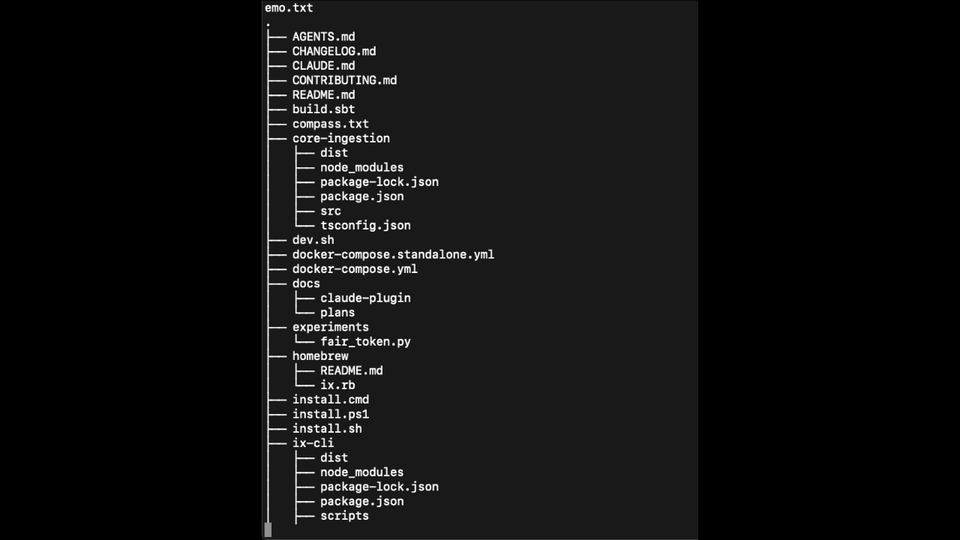
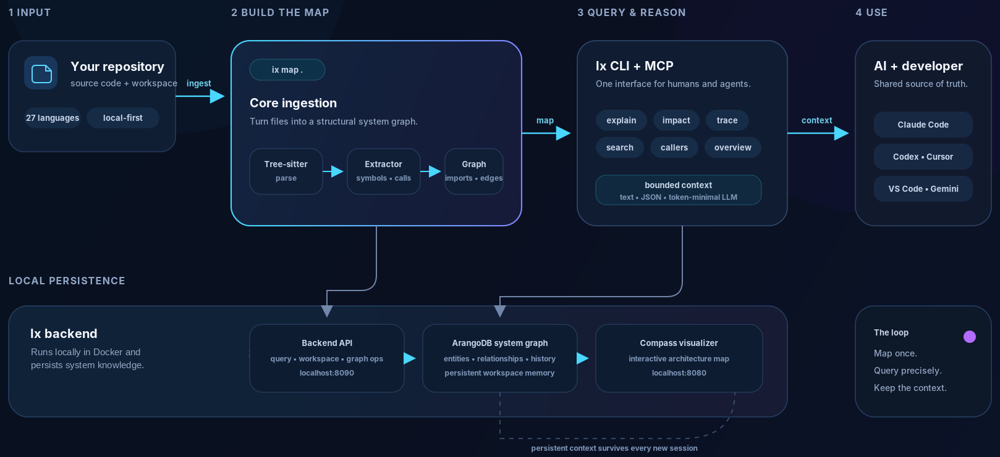

<p align="center">
  
</p>

<h1 align="center">Understand any codebase instantly.</h1>
<p align="center"><em>System intelligence for humans and AI.</em></p>

<p align="center">
  Ix parses your repository into a persistent system graph of symbols, calls, imports and relationships<br/>
  so you and your coding agents can query structure instead of grepping and guessing.
</p>

<p align="center">
  
  <a href="LICENSE"></a>
  <a href="https://github.com/ix-infrastructure/Ix/actions/workflows/ci.yml"></a>
  <a href="#install"></a>
  <a href="https://github.com/sponsors/ix-infrastructure"></a>
</p>

<p align="center">
  <a href="https://www.ix-infra.com/ix">Website</a> ·
  <a href="https://discord.gg/ncEYVHVqZ8">Discord</a> ·
  <a href="https://github.com/sponsors/ix-infrastructure">Sponsor</a>
</p>

---

### Try Ix

```bash
curl -fsSL https://ix-infra.com/install.sh | sh    # macOS / Linux
```

On Windows, use the PowerShell installer under [Install](#install).

<p align="center">
  
</p>

```bash
ix map .                      # build the graph for this repo
ix explain AuthService        # what is this, and what does it touch?
ix trace user_login_flow      # how does this actually flow?
ix impact verify_token        # what breaks if I change this?
```

The graph lives on your machine and persists between sessions. Your agent navigates
it through [MCP](#integrations) instead of re-deriving your architecture
from whatever fits in a prompt.

---

### Why Ix

| | Without Ix | With Ix |
|---|---|---|
| **Finding things** | Search, read, search again | Query a structured graph |
| **Architecture** | Re-derived every session | Mapped once, kept |
| **Agent context** | Whole files pasted into the prompt | Bounded structural slices |
| **Between sessions** | Context is lost | The graph persists |
| **Relationships** | Inferred from fragments | Read from real edges |

---

### The model

**Map → Structure → Retrieve → Remember**

| Step | What happens |
|---|---|
| **Map** | `ix map .` parses the repo with tree-sitter and extracts symbols, calls and imports. |
| **Structure** | Those become nodes and edges in a graph of what calls, contains and imports what. |
| **Retrieve** | Commands return bounded answers about one symbol or flow, not whole files. |
| **Remember** | The graph is stored locally and survives between sessions and agent runs. |

---

### How it works

<p align="center">
  
</p>

`ix map` parses your repository with tree-sitter, extracts symbols, calls and
imports, and persists them as a graph in a local backend: ArangoDB plus the memory
layer, run for you in Docker. Three clients read that graph: the `ix` CLI, the
`ix mcp` server your AI clients connect to, and Compass, the visualizer `ix view`
opens.

The backend ships as a released Docker image; it is not built from this repo. See
the [HTTP API reference](./docs/api/) for the endpoints all three clients share.

---

### Results

Across our own development work, querying the graph instead of feeding files into
the prompt cut token use by **30–99.7%**, varying widely with the task and the size
of the repo. These are internal measurements, not a published benchmark.

The mechanism is the plain part: `ix explain AuthService` returns that symbol and
its immediate relationships. Answering the same question by reading the file and
the files it imports costs far more, and costs it again next session.

---

### Integrations

Ix ships a stdio MCP server, so any MCP-capable client can use the same graph tools.

```bash
ix mcp install            # detect installed clients and register `ix mcp` with each
ix mcp install --dry-run  # show what would change, write nothing
ix mcp doctor             # check each client's registration
```

`install` knows **Claude Code, Codex, Cursor, VS Code, Gemini CLI, OpenClaw and
opencode**. It writes through each client's own MCP command where one exists, and
never overwrites a server name it does not own. Pass `--force` to replace one, or
`--host <id>` to limit the run. Per-client write mechanics, repair and process
isolation are in [docs/mcp.md](./docs/mcp.md).

To register one client by hand:

```bash
codex mcp add ix-memory -- ix mcp
```

#### Agent skill

[`skills/ix/`](skills/ix/SKILL.md) teaches any LLM agent to drive the CLI. It follows the
[Claude Code skill format](https://code.claude.com/docs/en/skills) and the
[agents.md](https://agents.md) standard, so Claude Code, Codex, Cursor and any agent
that reads `~/.agents/skills` all load the same tree from their own skills directory.

```bash
ix install                      # menu: pick harnesses, preview or apply, confirm before writing
bash scripts/install-skill.sh   # the same installer, no menu (--dry-run to preview, --json for a report)
```

`ix install` is a menu over `scripts/install-skill.sh`, run from an Ix checkout. Its rows come
from the script's own `--dry-run --json` preview, and it writes nothing until you confirm. Off a
terminal it prints a hint instead; `ix install --dry-run` and `ix install --yes` run the script
with the same options. It installs the skill only: MCP registration stays in `ix mcp install`.

Then ask your agent: *"Set up Ix and map this repo."*

#### Native plugins

Optional per-client packages, if you prefer them to `ix mcp install`:

```bash
# Claude Code
/plugin marketplace add ix-infrastructure/ix-claude-plugin
/plugin install ix-memory

# Codex
curl -fsSL https://ix-infra.com/codex-install.sh | sh

# OpenClaw
openclaw plugins install ix-infrastructure/ix-openclaw-plugin

# Gemini
gemini extensions install https://github.com/ix-infrastructure/ix-gemini-plugin

# OpenCode
curl -fsSL https://raw.githubusercontent.com/ix-infrastructure/ix-opencode-plugin/main/install.sh | bash

# Cursor
curl -fsSL https://raw.githubusercontent.com/ix-infrastructure/ix-cursor-plugin/main/install.sh | bash
```

On Windows, the Codex, OpenCode and Cursor installers each have a PowerShell
version at the same URL, with `.ps1` in place of `.sh`:

```powershell
irm https://ix-infra.com/codex-install.ps1 | iex
```

---

### Install

**macOS / Linux**

```bash
curl -fsSL https://ix-infra.com/install.sh | sh
```

**Windows**: install Node.js 22+ and Docker Desktop first, then:

```powershell
irm https://ix-infra.com/install.ps1 | iex
```

Then map a repo and register your AI clients:

```bash
ix map .
ix mcp install
```

The installer checks for and installs anything missing: **Node.js 22+, Git, ripgrep**
(powers `ix text`), and **Docker + Docker Compose** for the local backend. All you need
beforehand is a terminal with `curl` or `wget`.

<details>
<summary><b>Platform notes and edge cases</b></summary>

<br/>

Pre-built CLI packages are published for Apple Silicon macOS, Linux (x86-64 and
arm64) and Windows x86-64.

**Intel Macs** have no pre-built package. Install with Homebrew, which builds from
source:

```bash
brew tap ix-infrastructure/ix https://github.com/ix-infrastructure/Ix
brew install ix
```

For the full list, including the endpoints the installer reaches and the
directories it creates, see [docs/prerequisites.md](./docs/prerequisites.md).

</details>

**Upgrade**

```bash
ix upgrade --check   # see whether an update is available
ix upgrade           # upgrade the CLI, backend and components
```

**Uninstall**

```bash
curl -fsSL https://ix-infra.com/uninstall.sh | sh    # macOS / Linux
```

```powershell
irm https://ix-infra.com/uninstall.ps1 | iex         # Windows
```

This removes the CLI and the backend containers along with their data. To keep the
graph volume, set `IX_KEEP_DATA=1` for the script: `… | IX_KEEP_DATA=1 sh`, or
`$env:IX_KEEP_DATA = "1"` before the PowerShell line. If you installed with
Homebrew, run `brew uninstall ix` instead.

---

### Commands

Ix talks to a local backend, so start there if a command reports
`Ix backend not reachable`:

```bash
ix status          # is the backend reachable?
ix docker start    # start it (ArangoDB + memory layer)
ix doctor          # server, database and graph integrity
```

Set `IX_DEBUG=1` for full stack traces on any error.

**Build the graph**

```bash
ix map .           # map this repo
ix watch           # re-map on change
ix reset --workspace   # wipe this repo's graph (asks first)
ix reset              # wipe every repo on the backend (--code keeps goals, plans and decisions)
```

**Understand**

```bash
ix search <term>       # find an entity by name
ix text <term>         # plain text search across the repo (ripgrep)
ix locate <symbol>     # jump to a definition
ix explain <symbol>    # what it is and what it touches
ix overview <target>   # one-shot structural summary
ix impact <target>     # blast radius of a change
ix read <target>       # read source, by symbol or path:line-range
```

**Explore**

```bash
ix trace <symbol>      # follow a flow up and down
ix callers <symbol>    # what calls this
ix callees <symbol>    # what this calls
ix depends <symbol>    # everything that depends on this, as a tree
ix imports <symbol>    # what this imports (ix imported-by for the reverse)
ix rank --by dependents --top 10   # find the load-bearing code
ix inventory --kind function       # list components
ix history <target>    # how an entity changed
ix diff <from> <to>    # compare two revisions
```

**Inspect the system**

```bash
ix view            # open the Compass visualizer
ix subsystems      # the architectural map saved by ix map
ix stats           # graph statistics
ix smells          # detect structural issues
```

Query commands take `--format text|json|llm`. Use `llm` when an agent reads the
output. It is token-minimal and newline-delimited
([spec](./docs/llm-format.md)). Use `json` when chaining commands.

Exhaustive references: **[commands](skills/ix/references/commands.md)** ·
**[flags](skills/ix/references/flags.md)** ·
**[output formats](skills/ix/references/output-formats.md)** ·
**[troubleshooting](skills/ix/references/troubleshooting.md)**

---

### Supported languages

<!-- languages:code:start (generated from SupportedLanguages by ix-cli/scripts/check-language-docs.mjs --write) -->
Symbols, calls and imports are extracted across **27 languages**:

`JavaScript` `TypeScript` `Python` `Java` `C` `C++` `C#` `Go` `Ruby` `Rust`
`PHP` `Kotlin` `Swift` `Scala` `R` `SAS` `Elixir` `Makefile` `Lua` `Bash`
`PowerShell` `Haskell` `Zig` `HTML` `XML` `HCL / Terraform` `CSS`
<!-- languages:code:end -->

CUDA (`.cu` / `.cuh`) is parsed with the C++ grammar, including kernel-launch
syntax (`kernel<<<grid, block>>>(args)`), so host-to-kernel calls appear in the
graph. Python stub files (`.pyi`) are parsed as Python.

Config and data formats are parsed too, into config keys, headings, SQL tables
and views, proto messages and services, Dockerfile stages and LaTeX sections and
labels ([what each one yields](docs-site/src/content/docs/reference/languages.md#config-and-data-formats)):

<!-- languages:formats:start (generated from SupportedLanguages by ix-cli/scripts/check-language-docs.mjs --write) -->
`YAML` `Dockerfile` `SQL` `JSON` `TOML` `Markdown` `LaTeX` `Protocol Buffers`
<!-- languages:formats:end -->

---

### Contributing

Issues and pull requests are welcome. See [CONTRIBUTING.md](CONTRIBUTING.md) for local
setup, and [SECURITY.md](SECURITY.md) to report a vulnerability.

<p align="center">
  <a href="https://www.ix-infra.com/ix">Website</a> ·
  <a href="https://discord.gg/ncEYVHVqZ8">Discord</a> ·
  <a href="https://github.com/sponsors/ix-infrastructure">Sponsor</a>
</p>

<p align="center">
  Licensed under <a href="LICENSE">Apache 2.0</a>. ⭐ Star the repo if Ix is useful to you.
</p>
